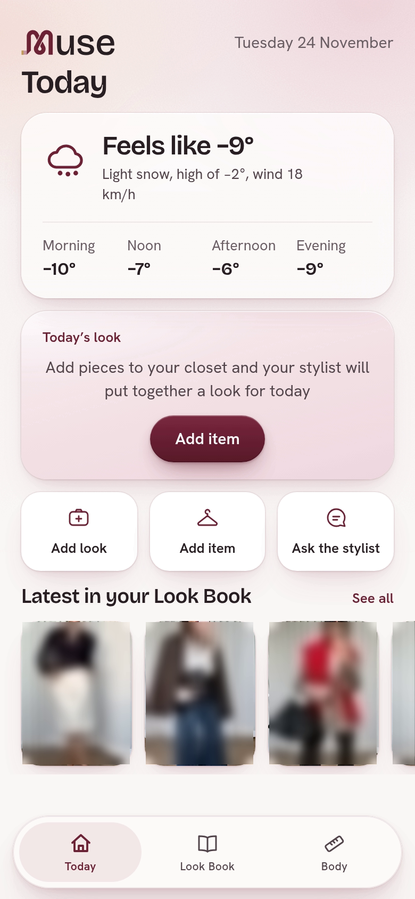
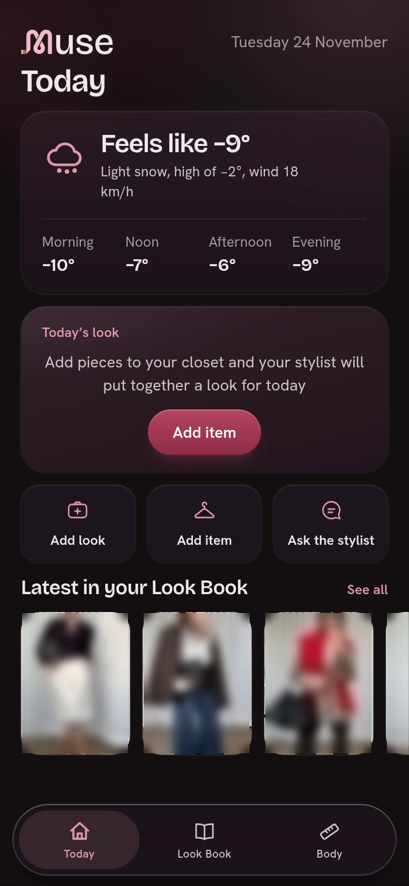
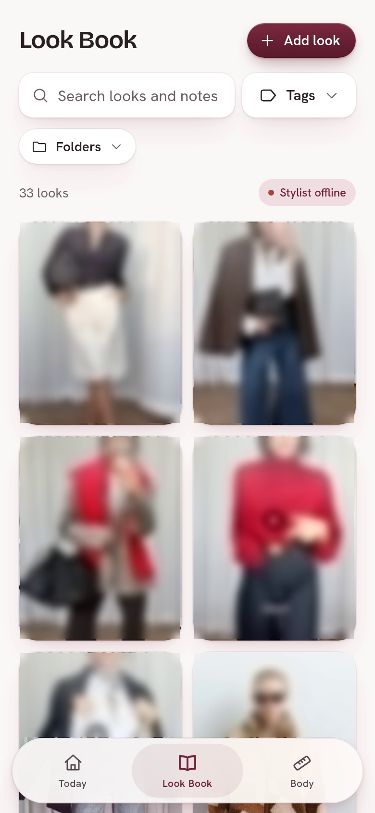
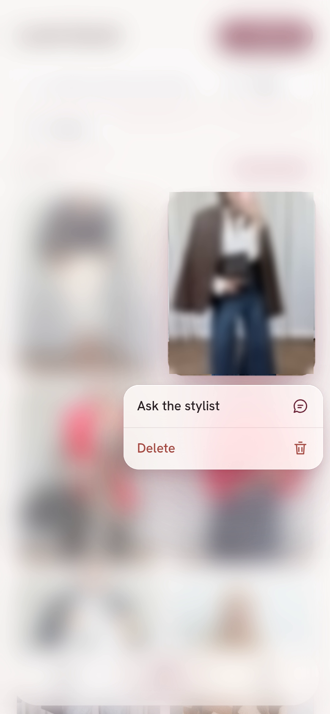
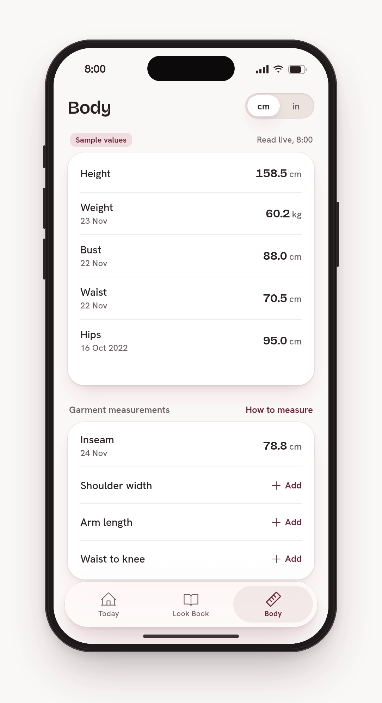

<h1 align="center">Muse</h1>

<b>A personal stylist that knows my wardrobe, my measurements and what the weather is doing today.</b>

> **This is a showcase.** The source code is private, because Muse is built around one person's closet and body. Here is what it is for and how it is designed. The screens below come from the app as it is today. The Body screen is a mockup, and every number on it is a sample.

Muse is a stylist and wardrobe app that I am building for my phone. It brings together the outfits I save, my exact measurements, my closet and the weather, and turns them into a suggestion for what to wear today.

## What it does

- **A Look Book for my inspiration.** I upload outfits in bulk from my photo library and sort them into folders and tags. The stylist tags each look and writes a short note on how it would work on me.
- **An exact body profile.** My measurements and proportions live in one place, so the stylist works from real numbers and never from a guess.
- **A closet catalogue.** Every item with its photos, link, care label and measurements, so the app can tell me "too long", "too wide" or "fine" before I order something online. This part is still being built.
- **An AI stylist.** It builds outfits from my closet for the day's weather, and knows the difference between a heated office and an outdoor walk, down to very cold days. It runs on a Claude subscription I already pay for, so there is no separate bill. I talk to it in Hebrew.

## A look

The Today screen is where it starts: the weather, a place for today's look, and three quick actions.

    

From the left: Today, Today in dark mode, the Look Book, the menu that opens when I long press a look, and Body.

## How I built it

The same way as my other projects: a team of AI agents, a human in the loop, and a quality check and a security check on every change.

## Want to see it work?

The code stays private, but I am happy to show you Muse live and talk through how it is designed.

Built by <a href="https://github.com/einavtayari">Einav</a>, the human in the loop.

